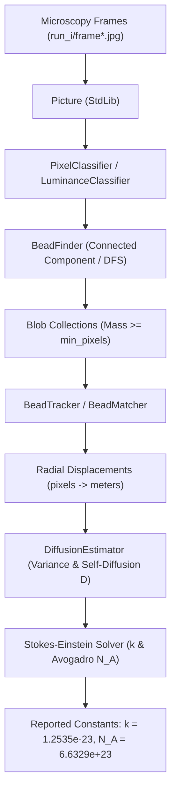

# Atomic Nature of Matter: Brownian Motion & Avogadro Estimation

[](https://www.oracle.com/java/)
[](#academic-integrity--submission)
[](#architecture--solid-design-principles)

A computational physics and computer vision system implemented in Java that replicates Jean Baptiste Perrin's 1908 Nobel Prize-winning experiment. By tracking microscopic polystyrene beads undergoing Brownian motion in water, the project validates Albert Einstein's 1905 kinetic theory and estimates fundamental physical constants: **Boltzmann's Constant ($k$)** and **Avogadro's Number ($N_A$)**.

---

## 📑 Table of Contents

- [Scientific Background & Overview](#-scientific-background--overview)
- [System Architecture & Pipeline](#-system-architecture--pipeline)
- [Project Directory Structure](#-project-directory-structure)
- [Mathematical & Physical Formulations](#-mathematical--physical-formulations)
- [Components & API Specification](#-components--api-specification)
  - [1. Imaging & Blob Detection (`Blob`, `BeadFinder`)](#1-imaging--blob-detection-blob-beadfinder)
  - [2. Particle Tracking (`BeadTracker`)](#2-particle-tracking-beadtracker)
  - [3. Statistical Physics & Estimation (`Avogadro`)](#3-statistical-physics--estimation-avogadro)
- [Build & Execution Guide](#-build--execution-guide)
- [Sample Execution & Verification](#-sample-execution--verification)
- [Datasets](#-datasets)

---

## 🔬 Scientific Background & Overview

In 1827, botanist Robert Brown observed erratic jittering of microscopic pollen grains suspended in water. In 1905, Albert Einstein formulated the first quantitative mathematical theory of this **Brownian Motion**, attributing the random movement to continuous statistical collisions with millions of invisible water molecules ($H_2O$).

In 1908, Jean Baptiste Perrin conducted precise quantitative ultramicroscopy experiments confirming Einstein's predictions, providing the first definitive empirical proof of the atomic nature of matter and yielding the earliest empirical estimate of Avogadro's constant.

This software automates Perrin's manual measurements through automated digital image processing:

1. **Blob Identification**: Discovers polystyrene micro-beads in noisy fluorescent microscopy frames via luminance thresholding and connected component analysis (Depth-First Search).
2. **Trajectory Tracking**: Tracks bead displacements across sequential video frames ($\Delta t = 0.5\text{ s}$) using nearest-neighbor Euclidean spatial matching.
3. **Statistical Inference**: Calculates the displacement variance ($\sigma^2$), determines the self-diffusion coefficient ($D$), and solves the **Stokes-Einstein relation** for Boltzmann's constant ($k$) and Avogadro's number ($N_A$).

---

## 🏗 System Architecture & Pipeline



---

## 📁 Project Directory Structure

```text
brownian-beads/
├── README.md                          # Project documentation and team metadata
├── .gitignore                         # Build and temporary file exclusions
│
├── Picture.java                       # Princeton stdlib image abstraction
├── Blob.java                          # Core domain object: connected component / bead
├── BeadFinder.java                    # Entry point & DFS component analysis
├── BeadTracker.java                   # Entry point & frame-to-frame displacement tracker
├── Avogadro.java                      # Entry point & thermodynamic constant estimator
│
├── imaging/                           # Package: Image processing & segmentation
│   ├── PixelClassifier.java           # Strategy interface for foreground classification
│   └── LuminanceClassifier.java       # Concrete luminance-based threshold classifier
│
├── tracking/                          # Package: Multi-frame trajectory association
│   ├── BeadMatcher.java               # Strategy interface for bead matching
│   └── NearestNeighborMatcher.java    # Nearest-neighbor Euclidean spatial matcher
│
├── physics/                           # Package: Statistical thermodynamics
│   ├── DiffusionEstimator.java        # Einstein-Smoluchowski & Stokes-Einstein calculations
│   └── PhysicalConstants.java         # Immutable physical and fluid constants
│
└── data/                              # Experimental video frames and sample data
    ├── brownian.gif                   # Brownian motion visualization
    ├── mp4/                           # Raw experimental video recordings (run_1.mp4 - run_10.mp4)
    ├── run_1/                         # 200 microscopy frames (frame00000.jpg - frame00199.jpg)
    └── ...                            # run_2 through run_10 datasets
```

---

## ➗ Mathematical & Physical Formulations

### 1. Blob Center of Mass

For a connected component containing $P$ pixels with coordinates $(x_i, y_i)$:
$$\bar{x} = \frac{1}{P} \sum_{i=1}^{P} x_i, \quad \bar{y} = \frac{1}{P} \sum_{i=1}^{P} y_i$$

### 2. Radial Displacement Conversion

Radial displacement in pixels:
$$r_i = \sqrt{(\Delta x_i)^2 + (\Delta y_i)^2}$$
Conversion to SI units (meters) using the microscope spatial resolution:
$$s = 0.175 \times 10^{-6} \text{ m/pixel}$$
$$r_{i,\text{meters}} = r_{i,\text{pixels}} \times s$$

### 3. Einstein-Smoluchowski Diffusion Equation

For 2D Brownian motion over frame interval $\Delta t = 0.5\text{ s}$ across $n$ displacements:
$$\sigma^2 = 2 D \Delta t \implies D = \frac{\sigma^2}{2 \Delta t} = \sigma^2 \quad (\text{since } 2 \times 0.5 = 1)$$
Variance of displacements:
$$\hat{\sigma}^2 = \frac{1}{2n} \sum_{i=1}^n r_{i,\text{meters}}^2 = \frac{1}{2n} \sum_{i=1}^n \left( (\Delta x_i)^2 + (\Delta y_i)^2 \right)$$

### 4. Stokes-Einstein Relation & Boltzmann's Constant

For a spherical particle moving through a viscous fluid:
$$D = \frac{k T}{6 \pi \eta \rho} \implies k = \frac{6 \pi \eta \rho D}{T}$$
**Experimental Constants**:

- Absolute Temperature: $T = 297\text{ K}$ ($24^\circ\text{C}$)
- Water Viscosity: $\eta = 9.135 \times 10^{-4}\text{ N}\cdot\text{s}\cdot\text{m}^{-2}$
- Bead Radius: $\rho = 0.5 \times 10^{-6}\text{ m}$

### 5. Avogadro's Number

With Universal Gas Constant $R = 8.31446\text{ J}\cdot\text{mol}^{-1}\cdot\text{K}^{-1}$:
$$N_A = \frac{R}{k}$$

---

## 💻 Components & API Specification

### 1. Imaging & Blob Detection (`Blob`, `BeadFinder`)

- **`Blob` API**:

  ```java
  public class Blob {
      public Blob();                          // Creates an empty blob
      public void add(int x, int y);          // Adds pixel (x, y) to this blob
      public int mass();                      // Number of pixels in the blob
      public double distanceTo(Blob that);    // Euclidean distance between centers of mass
      public String toString();               // Returns "%2d (%8.4f, %8.4f)", mass, x, y
  }
  ```

- **`BeadFinder` API**:

  ```java
  public class BeadFinder {
      // Finds all blobs with luminance >= tau
      public BeadFinder(Picture picture, double tau);

      // Returns all beads (blobs with mass >= min)
      public Blob[] getBeads(int min);

      // Test client: java BeadFinder min tau frame.jpg
      public static void main(String[] args);
  }
  ```

### 2. Particle Tracking (`BeadTracker`)

- Identifies beads in frame $t$ and frame $t + \Delta t$.
- For every bead in $t + \Delta t$, finds the nearest bead in frame $t$.
- If Euclidean distance $r \le \delta$, writes displacement $r$ formatted to 4 decimal places (`%.4f`).
- **CLI Usage**:

  ```bash
  java BeadTracker min tau delta frame1.jpg frame2.jpg ...
  ```

### 3. Statistical Physics & Estimation (`Avogadro`)

- Reads radial displacement stream ($r_1, r_2, \dots$) from standard input.
- Computes $D$, $k$, and $N_A$.
- **CLI Usage**:

  ```bash
  java Avogadro < displacements.txt
  ```

---

## 🚀 Build & Execution Guide

### Prerequisites

- Java Development Kit (JDK 11 or higher)
- Standard terminal / command line environment

### Compilation

Compile all core classes and domain packages from the root directory:

```bash
javac Picture.java Blob.java BeadFinder.java BeadTracker.java Avogadro.java imaging/*.java tracking/*.java physics/*.java
```

---

## 🧪 Sample Execution & Verification

### Step 1: Detect Beads in a Single Frame

```bash
java BeadFinder 25 180.0 data/run_1/frame00001.jpg
```

_Expected Output Format:_

```text
29 (214.7241,  82.8276)
36 (223.6111, 116.6667)
42 (260.2381, 234.8571)
35 (266.0286, 315.7143)
31 (286.5806, 355.4516)
...
```

### Step 2: Track Displacements Across Sequential Frames

```bash
java BeadTracker 25 180.0 25.0 data/run_1/frame00000.jpg data/run_1/frame00001.jpg
```

_Expected Output Format:_

```text
7.1833
4.7932
2.1693
5.5287
5.4292
4.3962
...
```

### Step 3: Estimate Physical Constants via Pipeline

```bash
java BeadTracker 25 180.0 25.0 data/run_1/*.jpg | java Avogadro
```

_Expected Output:_

```text
Boltzmann = 1.2535e-23
Avogadro  = 6.6329e+23
```

---

## 📊 Datasets

The repository contains 10 experimental datasets recorded at 2 frames per second ($\Delta t = 0.5\text{ s}$):

- `data/mp4/run_1.mp4` through `run_10.mp4`: Microscopic video recordings.
- `data/run_1/` through `data/run_10/`: Sequential frame sequences (200 JPEG frames per run, $640 \times 480$ resolution).
