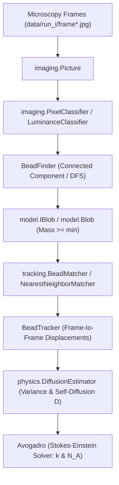

# Atomic Nature of Matter: Brownian Motion & Avogadro Estimation

[](https://www.oracle.com/java/)
[](#academic-integrity--submission)
[](#architecture--solid-design-principles)

A computational physics and computer vision system implemented in Java that replicates Jean Baptiste Perrin's 1908 Nobel Prize-winning experiment. By tracking microscopic polystyrene beads undergoing Brownian motion in water, the project validates Albert Einstein's 1905 kinetic theory and estimates fundamental physical constants: **Boltzmann's Constant ($k$)** and **Avogadro's Number ($N_A$)**.

---

## 📑 Table of Contents

- [Scientific Background & Overview](#-scientific-background--overview)
- [System Architecture & Pipeline](#-system-architecture--pipeline)
- [Project Directory Structure](#-project-directory-structure)
- [Mathematical & Physical Formulations](#-mathematical--physical-formulations)
- [Components & API Specification](#-components--api-specification)
  - [1. Domain Models (`model.IBlob`, `model.Blob`)](#1-domain-models-modeliblob-modelblob)
  - [2. Imaging & Segmentation (`imaging.*`, `BeadFinder`)](#2-imaging--segmentation-imaging-beadfinder)
  - [3. Particle Tracking (`tracking.*`, `BeadTracker`)](#3-particle-tracking-tracking-beadtracker)
  - [4. Statistical Physics & Estimation (`physics.*`, `Avogadro`)](#4-statistical-physics--estimation-physics-avogadro)
- [Build & Execution Guide](#-build--execution-guide)
- [Sample Execution & Verification](#-sample-execution--verification)
- [Datasets](#-datasets)

---

## 🔬 Scientific Background & Overview

In 1827, botanist Robert Brown observed erratic jittering of microscopic pollen grains suspended in water. In 1905, Albert Einstein formulated the first quantitative mathematical theory of this **Brownian Motion**, attributing the random movement to continuous statistical collisions with millions of invisible water molecules ($H_2O$).

In 1908, Jean Baptiste Perrin conducted precise quantitative ultramicroscopy experiments confirming Einstein's predictions, providing the first definitive empirical proof of the atomic nature of matter and yielding the earliest empirical estimate of Avogadro's constant.

This software automates Perrin's manual measurements through automated digital image processing:

1. **Blob Identification**: Discovers polystyrene micro-beads in noisy fluorescent microscopy frames via luminance thresholding and connected component analysis (Depth-First Search).
2. **Trajectory Tracking**: Tracks bead displacements across sequential video frames ($\Delta t = 0.5\text{ s}$) using nearest-neighbor Euclidean spatial matching.
3. **Statistical Inference**: Calculates the displacement variance ($\sigma^2$), determines the self-diffusion coefficient ($D$), and solves the **Stokes-Einstein relation** for Boltzmann's constant ($k$) and Avogadro's number ($N_A$).

---

## 🏗 System Architecture & Pipeline



---

## 📁 Project Directory Structure

```text
brownian-beads/
├── README.md                          # Project documentation and architecture guide
├── README_DESIGN.md                   # Detailed design blueprint and implementation roadmap
├── .gitignore                         # Build and temporary file exclusions
│
├── BeadFinder.java                    # Entry point: Single-frame bead detection & DFS analysis
├── BeadTracker.java                   # Entry point: Multi-frame particle tracking orchestrator
├── Avogadro.java                      # Entry point: Physical constant estimator (stdin stream)
│
├── model/                             # Package: Core domain abstractions and models
│   ├── IBlob.java                     # Interface representing a particle / connected component
│   └── Blob.java                      # Concrete bead implementation with center-of-mass tracking
│
├── imaging/                           # Package: Image processing and pixel classification
│   ├── Picture.java                   # 2D digital image representation and color abstraction
│   ├── PixelClassifier.java           # Strategy interface for pixel foreground/background classification
│   └── LuminanceClassifier.java       # Photometric luminance thresholding strategy
│
├── tracking/                          # Package: Frame-to-frame particle trajectory matching
│   ├── BeadMatcher.java               # Strategy interface for matching beads across consecutive frames
│   └── NearestNeighborMatcher.java    # Greedy nearest-neighbor spatial matching implementation
│
├── physics/                           # Package: Statistical thermodynamics and physical estimation
│   ├── PhysicalConstants.java         # Immutable physical and fluid constant definitions
│   └── DiffusionEstimator.java        # Einstein-Smoluchowski diffusion & Stokes-Einstein calculations
│
└── data/                              # Experimental video recordings and frame sequences
    ├── brownian.gif                   # Brownian motion visualization
    ├── mp4/                           # Raw video recordings (run_1.mp4 - run_10.mp4)
    └── run_1/ ... run_10/             # Sequential microscopy frames (frame00000.jpg - frame00199.jpg)
```

---

## ➗ Mathematical & Physical Formulations

### 1. Blob Center of Mass

For a connected component containing $P$ pixels with coordinates $(x_i, y_i)$:
$$\bar{x} = \frac{1}{P} \sum_{i=1}^{P} x_i, \quad \bar{y} = \frac{1}{P} \sum_{i=1}^{P} y_i$$

### 2. Radial Displacement Conversion

Radial displacement in pixels:
$$r_i = \sqrt{(\Delta x_i)^2 + (\Delta y_i)^2}$$
Conversion to SI units (meters) using the microscope spatial resolution:
$$s = 0.175 \times 10^{-6} \text{ m/pixel}$$
$$r_{i,\text{meters}} = r_{i,\text{pixels}} \times s$$

### 3. Einstein-Smoluchowski Diffusion Equation

For 2D Brownian motion over frame interval $\Delta t = 0.5\text{ s}$ across $n$ displacements:
$$\sigma^2 = 2 D \Delta t \implies D = \frac{\sigma^2}{2 \Delta t} = \sigma^2 \quad (\text{since } 2 \times 0.5 = 1)$$
Variance of displacements:
$$\hat{\sigma}^2 = \frac{1}{2n} \sum_{i=1}^n r_{i,\text{meters}}^2 = \frac{1}{2n} \sum_{i=1}^n \left( (\Delta x_i)^2 + (\Delta y_i)^2 \right)$$

### 4. Stokes-Einstein Relation & Boltzmann's Constant

For a spherical particle moving through a viscous fluid:
$$D = \frac{k T}{6 \pi \eta \rho} \implies k = \frac{6 \pi \eta \rho D}{T}$$
**Experimental Constants**:

- Absolute Temperature: $T = 297\text{ K}$ ($24^\circ\text{C}$)
- Water Viscosity: $\eta = 9.135 \times 10^{-4}\text{ N}\cdot\text{s}\cdot\text{m}^{-2}$
- Bead Radius: $\rho = 0.5 \times 10^{-6}\text{ m}$

### 5. Avogadro's Number

With Universal Gas Constant $R = 8.31446\text{ J}\cdot\text{mol}^{-1}\cdot\text{K}^{-1}$:
$$N_A = \frac{R}{k}$$

---

## 💻 Components & API Specification

### 1. Domain Models (`model.IBlob`, `model.Blob`)

- **`model.IBlob` Interface**:
  Defines the abstraction contract for a particle / connected component:

  ```java
  package model;

  public interface IBlob {
      double getCenterX();
      double getCenterY();
      int mass();
      void add(double x, double y);
      double distanceTo(IBlob that);
  }
  ```

- **`model.Blob` Implementation**:
  Maintains cumulative coordinates $(\sum x, \sum y)$ and pixel mass count:

  ```java
  package model;

  public class Blob implements IBlob {
      public Blob();                          // Creates an empty blob accumulator
      public double getCenterX();             // Returns center-of-mass x (sumX / mass)
      public double getCenterY();             // Returns center-of-mass y (sumY / mass)
      public int mass();                      // Returns total pixel count
      public void add(double x, double y);    // Adds coordinate (x, y) to the blob
      public double distanceTo(IBlob that);   // Euclidean distance between centroids
      public String toString();               // Formatted as: "%2d (%8.4f, %8.4f)"
  }
  ```

### 2. Imaging & Segmentation (`imaging.*`, `BeadFinder`)

- **`imaging.Picture`**:
  Wrapper around digital 2D images allowing individual pixel coordinate access and RGB color extraction (`get(col, row)`, `width()`, `height()`).

- **`imaging.PixelClassifier` Interface**:
  Strategy interface decoupling pixel segmentation rules from image traversal:

  ```java
  package imaging;
  import java.awt.Color;

  public interface PixelClassifier {
      boolean isForeground(Color color);
  }
  ```

- **`imaging.LuminanceClassifier`**:
  Calculates ITU-R/NTSC photometric luminance:
  $$Y = 0.299 \times R + 0.587 \times G + 0.114 \times B$$
  Returns `true` if $Y \ge \tau$ (foreground bead pixel), `false` otherwise.

- **`BeadFinder`**:
  Performs single-frame segmentation using 4-connected Depth-First Search (DFS):

  ```java
  public class BeadFinder {
      // Initializes segmentation structures with luminance threshold tau
      public BeadFinder(Picture picture, double tau);

      // Traverses image and labels connected components via DFS
      public void detectBlobs();

      // Returns all beads with mass >= min
      public List<IBlob> getBeads(int min);

      // Test client: java BeadFinder <min> <tau> <image_path>
      public static void main(String[] args);
  }
  ```

### 3. Particle Tracking (`tracking.*`, `BeadTracker`)

- **`tracking.BeadMatcher` Interface**:
  Strategy contract for multi-frame particle correspondence:

  ```java
  package tracking;
  import java.util.List;
  import model.IBlob;

  public interface BeadMatcher {
      List<Double> match(List<IBlob> current, List<IBlob> previous, int maxDistance);
  }
  ```

- **`tracking.NearestNeighborMatcher`**:
  Greedy nearest-neighbor association:
  - For each particle in the `current` frame, finds the nearest particle in the `previous` frame via Euclidean distance.
  - Matches with displacement $< \text{maxDistance}$ are retained and returned.

- **`BeadTracker`**:
  CLI entry point orchestrating particle tracking across frame sequences:
  - Reads consecutive frame pairs (`frame[i]` and `frame[i+1]`).
  - Detects beads via `BeadFinder` and matches pairs via `BeadMatcher`.
  - Outputs displacement stream formatted to 4 decimal places (`%.4f`).
  - **CLI Usage**:

    ```bash
    java BeadTracker <min> <tau> <delta> frame1.jpg frame2.jpg ...
    ```

### 4. Statistical Physics & Estimation (`physics.*`, `Avogadro`)

- **`physics.PhysicalConstants`**:
  Encapsulates fluid dynamics and physical constants ($T$, $\eta$, $\rho$, $R$, and pixel-to-meter factor $s = 0.175 \times 10^{-6}\text{ m/pixel}$).

- **`physics.DiffusionEstimator`**:
  Statistical engine computing displacement variance $\sigma^2$, self-diffusion coefficient $D$, Boltzmann's constant $k$, and Avogadro's number $N_A$.

- **`Avogadro`**:
  CLI entry point consuming standard input displacement streams:

  ```bash
  java Avogadro < displacements.txt
  ```

---

## 🚀 Build & Execution Guide

### Prerequisites

- Java Development Kit (JDK 11 or higher; tested on OpenJDK 21 / 25)
- Standard terminal / command line environment

### Compilation

Compile all domain models, imaging, tracking, physics packages, and entry points:

```bash
javac model/*.java imaging/*.java tracking/*.java physics/*.java BeadFinder.java BeadTracker.java Avogadro.java
```

---

## 🧪 Sample Execution & Verification

### Step 1: Detect Beads in a Single Frame

```bash
java BeadFinder 25 180.0 data/run_1/frame00001.jpg
```

_Expected Output Format:_

```text
29 (214.7241,  82.8276)
36 (223.6111, 116.6667)
42 (260.2381, 234.8571)
35 (266.0286, 315.7143)
31 (286.5806, 355.4516)
...
```

### Step 2: Track Displacements Across Sequential Frames

```bash
java BeadTracker 25 180.0 25.0 data/run_1/frame00000.jpg data/run_1/frame00001.jpg
```

_Expected Output Format:_

```text
7.1833
4.7932
2.1693
5.5287
5.4292
4.3962
...
```

### Step 3: Estimate Physical Constants via Pipeline

```bash
java BeadTracker 25 180.0 25.0 data/run_1/*.jpg | java Avogadro
```

_Expected Output:_

```text
Boltzmann = 1.2535e-23
Avogadro  = 6.6329e+23
```

---

## 📊 Datasets

The repository contains 10 experimental datasets recorded at 2 frames per second ($\Delta t = 0.5\text{ s}$):

- `data/mp4/run_1.mp4` through `run_10.mp4`: Microscopic video recordings.
- `data/run_1/` through `data/run_10/`: Sequential frame sequences (200 JPEG frames per run, $640 \times 480$ resolution).
