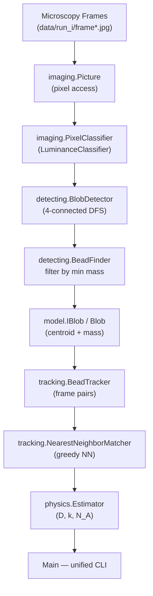

# Brownian Beads — Atomic Nature of Matter

[](https://www.oracle.com/java/)
[](#architecture)

A computational physics and computer vision system in Java that replicates Jean Baptiste Perrin's Nobel Prize-winning experiment (1926). By tracking microscopic polystyrene beads undergoing Brownian motion in water, the project validates Albert Einstein's 1905 kinetic theory and estimates two fundamental physical constants: **Boltzmann's constant (*k*)** and **Avogadro's number (*N_A*)**.

---

## Table of Contents

- [Scientific Background](#-scientific-background)
- [Architecture](#-architecture)
- [Project Structure](#-project-structure)
- [Mathematical Formulation](#-mathematical-formulation)
- [Package & API Reference](#-package--api-reference)
- [Build & Run](#-build--run)
- [Datasets](#-datasets)

---

## 🔬 Scientific Background

In 1827, Robert Brown observed erratic jittering of microscopic pollen grains suspended in water. In 1905, Albert Einstein gave the first rigorous mathematical treatment of this **Brownian motion**, attributing the random walk to continuous collisions with water molecules.

In 1908, Jean Baptiste Perrin conducted precise ultramicroscopy experiments that confirmed Einstein's predictions, providing the first empirical proof of the atomic nature of matter and an early estimate of Avogadro's constant.

This project automates Perrin's manual measurements via three automated stages:

1. **Blob detection** – Locates polystyrene micro-beads in noisy fluorescence microscopy frames using luminance thresholding and 4-connected DFS.
2. **Particle tracking** – Matches beads across consecutive video frames (Δt = 0.5 s) using greedy nearest-neighbour matching.
3. **Statistical estimation** – Computes displacement variance, the self-diffusion coefficient *D*, Boltzmann's constant *k*, and Avogadro's number *N_A* via the Stokes–Einstein relation.

---

## 🏗 Architecture

The system is organised as a clean four-layer pipeline, each layer exposed behind an interface and independently testable:



---

## 📁 Project Structure

```text
brownian-beads/
├── Main.java                        # Unified CLI entry point (beads / track / estimate)
│
├── model/                           # Domain abstractions
│   ├── IBlob.java                   # Particle interface (centroid, mass, distance)
│   ├── Blob.java                    # Accumulator implementation (centre-of-mass tracking)
│   └── BlobFactory.java             # Factory creating IBlob instances
│
├── imaging/                         # Image I/O and pixel classification
│   ├── Picture.java                 # Princeton stdlib Picture wrapper (pixel-level access)
│   ├── PixelClassifier.java         # Interface: isForeground(Color) + getForegroundPixels()
│   ├── LuminanceClassifier.java     # ITU-R luminance threshold classifier
│   ├── ImageConverter.java          # Interface: convert(Picture) → Picture
│   └── GrayscaleConverter.java      # Binarises an image using a PixelClassifier
│
├── detecting/                       # Connected-component analysis
│   ├── BlobDetector.java            # 4-connected DFS over foreground pixel grid
│   └── BeadFinder.java              # Static filter: keeps blobs with mass ≥ min
│
├── tracking/                        # Multi-frame particle correspondence
│   ├── BeadMatcher.java             # Interface: matchDistance(current, previous, maxDist)
│   ├── NearestNeighborMatcher.java  # Greedy nearest-neighbour implementation
│   └── BeadTracker.java             # Iterates consecutive frame pairs
│
├── physics/                         # Statistical physics
│   ├── PhysicalConstants.java       # T, η, r, s, R constants
│   └── Estimator.java               # Variance → D → k → N_A
│
└── data/
    ├── brownian.gif                 # Annotated animation of Brownian motion
    ├── mp4/run_1.mp4 … run_10.mp4   # Raw microscopy videos
    └── run_1/ … run_10/             # 200 JPEG frames per run (640 × 480 px)
```

---

## 📐 Mathematical Formulation

### Luminance threshold

Each pixel's brightness is computed with the ITU-R 601 luma formula:

$$Y = 0.299\,R + 0.587\,G + 0.114\,B$$

A pixel is foreground (bright bead) if $Y \ge \tau$.

### Centroid of a blob

For a connected component of $n$ foreground pixels at coordinates $(x_i, y_i)$:

$$\bar{x} = \frac{1}{n}\sum_{i=1}^{n} x_i, \qquad \bar{y} = \frac{1}{n}\sum_{i=1}^{n} y_i$$

### Self-diffusion coefficient

Given $N$ measured displacement magnitudes $r_i$ (in metres):

$$D = \frac{1}{2N} \sum_{i=1}^{N} r_i^2$$

(derived from the 2-D Einstein relation $\langle r^2 \rangle = 2D\,\Delta t$ with $\Delta t$ absorbed into the frame-rate calibration.)

### Stokes–Einstein relation → Boltzmann's constant

$$k = \frac{6\pi\,\eta\,\rho\,D}{T}$$

| Symbol | Meaning | Value |
|---|---|---|
| $T$ | Temperature | 297 K |
| $\eta$ | Water viscosity | 9.135 × 10⁻⁴ N s m⁻² |
| $\rho$ | Bead radius | 0.5 × 10⁻⁶ m |
| $s$ | Pixel scale | 0.175 × 10⁻⁶ m pixel⁻¹ |
| $R$ | Gas constant | 8.31446 J mol⁻¹ K⁻¹ |

### Avogadro's number

$$N_A = \frac{R}{k}$$

---

## 📦 Package & API Reference

### `model` — Domain objects

```java
public interface IBlob {
    double getCenterX();               // x-coordinate of centroid
    double getCenterY();               // y-coordinate of centroid
    int    mass();                     // number of pixels in blob
    void   add(double x, double y);    // accumulate a pixel
    double distanceTo(IBlob that);     // Euclidean distance between centroids
}
```

`Blob` implements `IBlob` by accumulating pixel-coordinate sums and dividing on demand. `BlobFactory` encapsulates `IBlob` instantiation.

---

### `imaging` — Pixel classification & binarisation

```java
// Strategy interface
public interface PixelClassifier {
    boolean     isForeground(Color color);
    boolean[][] getForegroundPixels(Picture image);
}

// ITU-R luma implementation
public class LuminanceClassifier implements PixelClassifier { … }

// Converts a colour Picture to a binary (white/black) Picture
public interface ImageConverter { Picture convert(Picture image); }
public class GrayscaleConverter implements ImageConverter { … }
```

---

### `detecting` — Blob detection

```java
// Runs 4-connected DFS over the foreground boolean grid
public class BlobDetector {
    public List<IBlob> detect(boolean[][] foregroundPixels);
}

// Filters a blob list by minimum mass
public class BeadFinder {
    public static List<IBlob> filter(List<IBlob> blobs, int min);
}
```

---

### `tracking` — Multi-frame correspondence

```java
// Strategy interface
public interface BeadMatcher {
    List<Double> matchDistance(List<IBlob> current, List<IBlob> previous, double maxDistance);
}

// Greedy O(n·m) nearest-neighbour implementation
public class NearestNeighborMatcher implements BeadMatcher { … }

// Iterates consecutive frame pairs and collects displacements
public class BeadTracker {
    public BeadTracker(List<List<IBlob>> blobsList, BeadMatcher beadMatcher);
    public List<List<Double>> trackDistance(double maxDistance);
}
```

---

### `physics` — Estimation engine

```java
public class PhysicalConstants {
    public static final double TEMPERATURE      = 297.0;     // K
    public static final double VISCOSITY        = 9.135E-4;  // N·s/m²
    public static final double BEAD_RADIUS      = 0.5E-6;    // m
    public static final double METERS_PER_PIXEL = 0.175E-6;  // m/px
    public static final double GAS_CONSTANT     = 8.31446;   // J/(mol·K)
}

public class Estimator {
    public Estimator(List<Double> displacements);  // pixel displacements
    public double calculateDiffusion();
    public double calculateBoltzmann();
    public double calculateAvogadro();
}
```

---

### `Main` — Unified CLI

All three modes are exposed through a single entry point:

```
Usage:
  beads    <min> <tau> <image>
  track    <min> <tau> <maxDistance> <image>...
  estimate <min> <tau> <maxDistance> <image>...
```

| Mode | Description |
|---|---|
| `beads` | Detects and prints all blobs with mass ≥ `min` in one image; also displays a binarised preview. |
| `track` | Prints pixel displacements across consecutive frames to stdout. |
| `estimate` | Runs the full pipeline and prints Boltzmann's constant and Avogadro's number. |

---

## 🚀 Build & Run

### Prerequisites

- Java Development Kit (JDK 11 or later; tested with OpenJDK 21/25)

### Compile

```bash
javac model/*.java imaging/*.java detecting/*.java tracking/*.java physics/*.java Main.java
```

### Examples

**Detect beads in one frame:**

```bash
java Main beads 25 180.0 data/run_1/frame00001.jpg
```

```
29 (214.7241,  82.8276)
36 (223.6111, 116.6667)
42 (260.2381, 234.8571)
...
```

**Print displacements for two consecutive frames:**

```bash
java Main track 25 180.0 25.0 data/run_1/frame00000.jpg data/run_1/frame00001.jpg
```

```
7.1833
4.7932
2.1693
...
```

**Estimate physical constants from an entire run:**

```bash
java Main estimate 25 180.0 25.0 data/run_4/*.jpg
```

```
Boltzmann = 1.3811E-23
Avogadro  = 6.0201E+23
```

---

## 📊 Datasets

Ten experimental microscopy datasets are included, each recorded at **2 frames per second** (Δt = 0.5 s):

| Path | Contents |
|---|---|
| `data/mp4/run_1.mp4` … `run_10.mp4` | Raw microscopy video recordings |
| `data/run_1/` … `data/run_10/` | 200 JPEG frames per run, 640 × 480 px |
| `data/brownian.gif` | Animated overview of Brownian motion |
