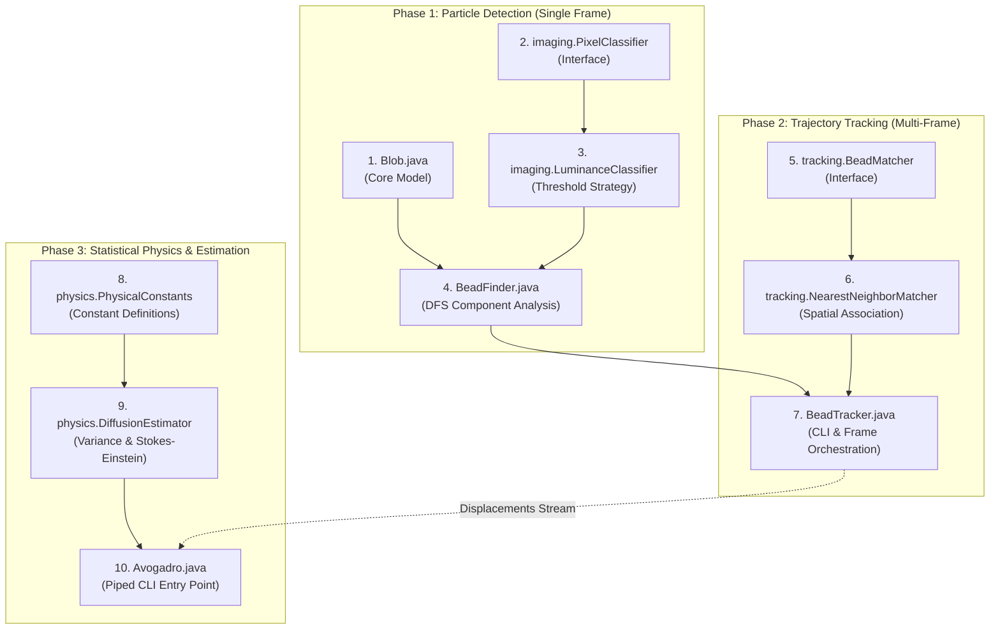

## 🗺️ Implementation Roadmap & Dependency Order



---

## 🔬 Phase 1: Particle Detection (Single Frame)

In this phase, you build the capability to identify individual polystyrene beads in a single microscopic image using luminance thresholding and connected component labeling.

---

### Step 1: `Blob.java`

* **Role & Dependencies**:
  - Fundamental domain model.
  - **Dependencies**: 0 project dependencies (depends only on Java standard library).
* **What it should do:**
  Represents a single connected component (a cluster of contiguous foreground pixels or an identified bead) on a 2D image grid. Encapsulates coordinate accumulation, center-of-mass calculation, spatial Euclidean distance, and assignment string formatting.
* **Internal State & Attributes:**
  - Running sum of all $x$-coordinates ($\sum x$).
  - Running sum of all $y$-coordinates ($\sum y$).
  - Total mass $P$ (the number of constituent pixels added so far).
* **How it should do it (Algorithmic Logic):**
  - **`Blob()`**: Initialize the accumulator sums ($\sum x = 0$, $\sum y = 0$) and pixel counter ($P = 0$).
  - **`add(int x, int y)`**:
    1. Add coordinate $x$ to $\sum x$.
    2. Add coordinate $y$ to $\sum y$.
    3. Increment mass counter $P$ by 1.
  - **`mass()`**:
    - Return integer count $P$.
  - **`distanceTo(Blob that)`**:
    1. Compute centroid $(\bar{x}_1, \bar{y}_1) = (\frac{\sum x_1}{P_1}, \frac{\sum y_1}{P_1})$ of this blob.
    2. Compute centroid $(\bar{x}_2, \bar{y}_2) = (\frac{\sum x_2}{P_2}, \frac{\sum y_2}{P_2})$ of the other blob.
    3. Calculate Euclidean distance:
       $$\text{dist} = \sqrt{(\bar{x}_1 - \bar{x}_2)^2 + (\bar{y}_1 - \bar{y}_2)^2}$$
    4. Return the double result.
  - **`toString()`**:
    - Format mass and centroid to four decimal places enclosed in parentheses: `%2d (%8.4f, %8.4f)`, e.g., `31 (370.9355, 365.4194)`.

---

### Step 2: `imaging/PixelClassifier.java`

* **Role & Dependencies**:
  - Abstraction interface for pixel segmentation.
  - **Dependencies**: 0 project dependencies.
* **What it should do:**
  Declares a strategy contract to determine if an individual pixel or color value is part of the foreground (bead) or background (fluid).
* **How it should do it (Contract):**
  - Expose a single method, e.g., `boolean isForeground(java.awt.Color color)`.
  - Enables the Open/Closed Principle: new segmentation strategies (e.g., adaptive thresholding) can be swapped in without modifying graph traversal code.

---

### Step 3: `imaging/LuminanceClassifier.java`

* **Role & Dependencies**:
  - Concrete segmentation strategy implementing `PixelClassifier`.
  - **Dependencies**: Depends on `PixelClassifier` and `java.awt.Color`.
* **What it should do:**
  Evaluates pixel foreground membership using monochrome photometric luminance against a specified threshold $\tau$.
* **Internal State & Attributes:**
  - Threshold value $\tau \in [0, 255]$.
* **How it should do it (Algorithmic Logic):**
  - Extract the red ($R$), green ($G$), and blue ($B$) channels from the color.
  - Calculate perceived photometric luminance via standard NTSC/ITU-R weights:
    $$Y = 0.299 \times R + 0.587 \times G + 0.114 \times B$$
  - Return `true` if $Y \ge \tau$ (foreground), and `false` if $Y < \tau$ (background).

---

### Step 4: `BeadFinder.java`

* **Role & Dependencies**:
  - Main component analysis engine and Phase 1 CLI client.
  - **Dependencies**: Depends on `Picture`, `Blob`, and `PixelClassifier` / `LuminanceClassifier`.
* **What it should do:**
  Scans an entire image frame, segments all connected foreground pixels into `Blob` objects using Depth-First Search (DFS), and filters out noise by retaining only beads with $\text{mass} \ge \text{min}$.
* **Internal State & Attributes:**
  - Reference to `Picture`.
  - Threshold $\tau$.
  - Master collection of identified blobs.
* **How it should do it (Algorithmic Logic):**
  - **Constructor `BeadFinder(Picture picture, double tau)`**:
    1. Read picture dimensions ($W, H$).
    2. Maintain a 2D boolean grid `visited[W][H]` initialized to `false`.
    3. Iterate through every pixel coordinate $(x, y)$:
       - If `visited[x][y]` is `true`, skip.
       - Check if the pixel is foreground via `LuminanceClassifier` (luminance $\ge \tau$).
       - If background, mark visited and continue.
       - If foreground and unvisited:
         - Create a new empty `Blob`.
         - Start a recursive or stack-based **Depth-First Search (DFS)** exploring 4-connected neighbors (up, down, left, right).
         - For each valid in-bounds neighbor that is unvisited and foreground: mark it visited and add it to the active `Blob`.
         - Once exploration completes, store the completed `Blob` in the internal collection.
  - **`getBeads(int min)`**:
    - Filter the blob collection, returning an array of blobs where `mass() >= min`.
  - **`main(String[] args)` (Phase 1 CLI)**:
    - Parse `args[0]` as integer `min`, `args[1]` as double `tau`, and `args[2]` as string `imagePath`.
    - Run `BeadFinder` on the image and print each bead's `toString()` output.

---

### Phase 1 Verification
```bash
javac Picture.java Blob.java imaging/*.java BeadFinder.java
java BeadFinder 25 180.0 data/run_1/frame00001.jpg
```
*Expected: Prints 13 beads matching the reference output in the project specification.*

---

## 🛰️ Phase 2: Trajectory Tracking (Multi-Frame)

In this phase, you build the capability to associate beads across consecutive temporal frames and measure spatial displacement.

---

### Step 5: `tracking/BeadMatcher.java`

* **Role & Dependencies**:
  - Abstraction interface for particle matching.
  - **Dependencies**: Depends on bead/coordinate models.
* **What it should do:**
  Declares the contract for matching beads between frame $t$ and frame $t + \Delta t$ within a maximum allowable distance $\delta$.
* **How it should do it (Contract):**
  - Expose a method accepting two collections of beads/coordinates and distance cutoff $\delta$.
  - Return the collection of valid Euclidean displacements between successfully paired beads.

---

### Step 6: `tracking/NearestNeighborMatcher.java`

* **Role & Dependencies**:
  - Concrete spatial tracking strategy implementing `BeadMatcher`.
  - **Dependencies**: Depends on `BeadMatcher` and `Blob`.
* **What it should do:**
  Performs greedy nearest-neighbor spatial matching between two collections of beads.
* **How it should do it (Algorithmic Logic):**
  1. For each bead in the current frame ($t + \Delta t$):
     - Iterate through all candidate beads in the previous frame ($t$).
     - Identify the candidate that minimizes Euclidean distance $d$.
     - If minimum distance $d_{\min} \le \delta$, record $d_{\min}$ as a valid displacement.
     - If $d_{\min} > \delta$, ignore it (particle left the field or focus).
  2. Return all recorded displacements.

---

### Step 7: `BeadTracker.java`

* **Role & Dependencies**:
  - Trajectory tracking orchestrator and Phase 2 CLI client.
  - **Dependencies**: Depends on `BeadFinder` and `BeadMatcher` / `NearestNeighborMatcher`.
* **What it should do:**
  Processes an ordered sequence of microscopy frames, delegates bead matching between successive pairs, and prints displacements.
* **How it should do it (Algorithmic Logic):**
  - **`main(String[] args)`**:
    1. Parse `args[0]` (`min`), `args[1]` (`tau`), and `args[2]` (`delta`).
    2. Read remaining arguments (`args[3]` to `args[N-1]`) as frame file paths.
    3. Run `BeadFinder` on the first frame (`args[3]`) to get `prevBeads`.
    4. Loop through subsequent frames $k = 4, \dots, N-1$:
       - Run `BeadFinder` on frame $k$ to get `currBeads`.
       - Match `currBeads` against `prevBeads` using `NearestNeighborMatcher` with cutoff `delta`.
       - Print each resulting displacement formatted to four decimal places (`%.4f`) on a new line.
       - Advance tracking: set `prevBeads = currBeads`.

---

### Phase 2 Verification
```bash
javac tracking/*.java BeadTracker.java
java BeadTracker 25 180.0 25.0 data/run_1/frame00000.jpg data/run_1/frame00001.jpg
```
*Expected: Prints frame-to-frame displacement values (`7.1833`, `4.7932`, etc.).*

---

## ⚡ Phase 3: Statistical Physics & Estimation

In this phase, you convert tracked pixel displacements into SI units and apply Einstein's kinetic theory and the Stokes-Einstein relation to estimate fundamental physical constants.

---

### Step 8: `physics/PhysicalConstants.java`

* **Role & Dependencies**:
  - Pure constants holder and single source of truth.
  - **Dependencies**: 0 project dependencies.
* **What it should do:**
  Defines all experimental and thermodynamic constants specified in the research paper:
  - `TEMPERATURE` ($T = 297.0\text{ K}$)
  - `VISCOSITY` ($\eta = 9.135 \times 10^{-4}\text{ N}\cdot\text{s}\cdot\text{m}^{-2}$)
  - `BEAD_RADIUS` ($\rho = 0.5 \times 10^{-6}\text{ m}$)
  - `METERS_PER_PIXEL` ($s = 0.175 \times 10^{-6}\text{ m/px}$)
  - `GAS_CONSTANT` ($R = 8.31446\text{ J}\cdot\text{mol}^{-1}\cdot\text{K}^{-1}$)
  - `DELTA_T` ($\Delta t = 0.5\text{ s}$)

---

### Step 9: `physics/DiffusionEstimator.java`

* **Role & Dependencies**:
  - Mathematical engine for statistical mechanics calculations.
  - **Dependencies**: Depends on `PhysicalConstants`.
* **What it should do:**
  Encapsulates the variance computation, self-diffusion estimation, and inverted Stokes-Einstein equations.
* **How it should do it (Algorithmic Logic):**
  - **Displacement Variance**:
    Given $n$ radial displacements in meters:
    $$\hat{\sigma}^2 = \frac{1}{2n} \sum_{i=1}^n r_{i,\text{meters}}^2$$
  - **Diffusion Coefficient ($D$)**:
    $$D = \frac{\hat{\sigma}^2}{2 \Delta t} \quad (\text{with } \Delta t = 0.5\text{ s}, \text{ so } D = \hat{\sigma}^2)$$
  - **Boltzmann's Constant ($k$)**:
    Solve Stokes-Einstein relation for $k$:
    $$k = \frac{6 \pi \eta \rho D}{T}$$
  - **Avogadro's Number ($N_A$)**:
    $$N_A = \frac{R}{k}$$

---

### Step 10: `Avogadro.java`

* **Role & Dependencies**:
  - Final pipeline entry point and Phase 3 CLI client.
  - **Dependencies**: Depends on `DiffusionEstimator` and `PhysicalConstants`.
* **What it should do:**
  Reads radial displacements from standard input stream, converts units, delegates thermodynamic calculations to `DiffusionEstimator`, and prints the final constants.
* **How it should do it (Algorithmic Logic):**
  - **`main(String[] args)`**:
    1. Read double values ($r_{\text{pixels}}$) sequentially from standard input until EOF.
    2. Convert each displacement to meters: $r_{\text{meters}} = r_{\text{pixels}} \times (0.175 \times 10^{-6}\text{ m/px})$.
    3. Accumulate sum of squares and count $n$.
    4. Compute $D$, $k$, and $N_A$ using `DiffusionEstimator`.
    5. Print the formatted constants in scientific notation with four decimal places:
       ```text
       Boltzmann = 1.2535e-23
       Avogadro  = 6.6329e+23
       ```

---

### Phase 3 Verification
```bash
javac physics/*.java Avogadro.java
java BeadTracker 25 180.0 25.0 data/run_1/*.jpg | java Avogadro
```
*Expected: Outputs Boltzmann's Constant and Avogadro's Number matching empirical values.*

---

## 🛠️ Pre-existing Utility: `Picture.java`

* **Status**: Provided as a project asset (Princeton IntroCS standard library).
* **Role**: Handles reading JPEG/PNG image files, window display, and pixel color extraction via `get(int col, int row)` returning `java.awt.Color`.
